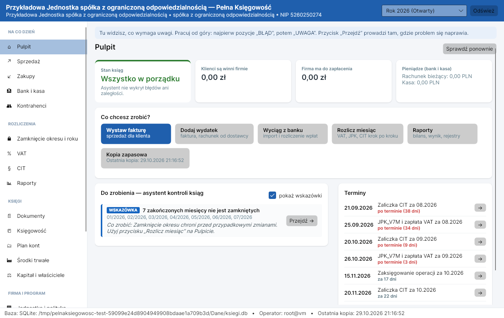
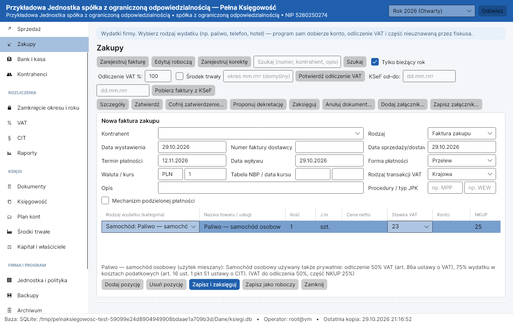
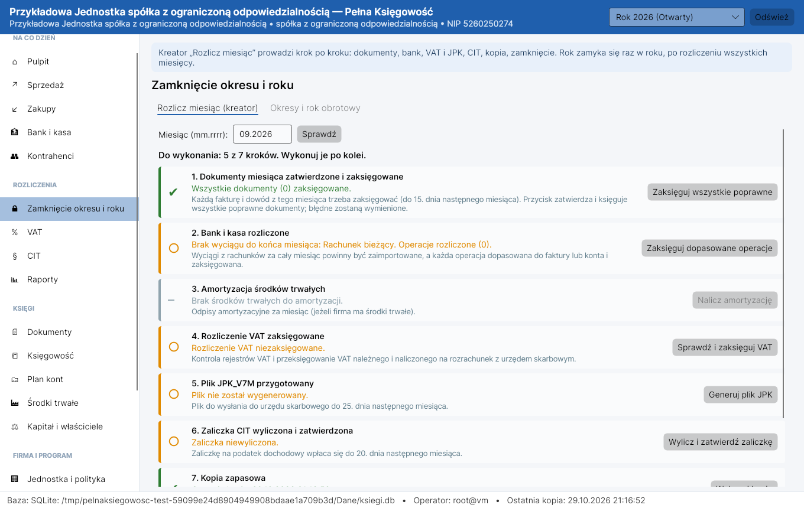
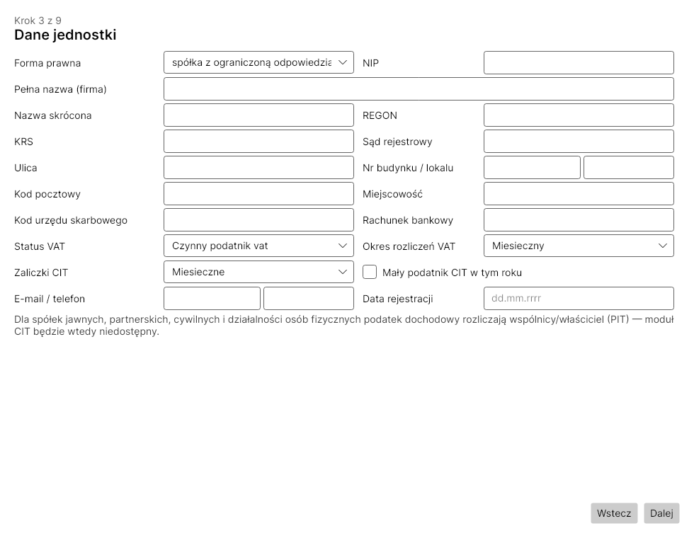
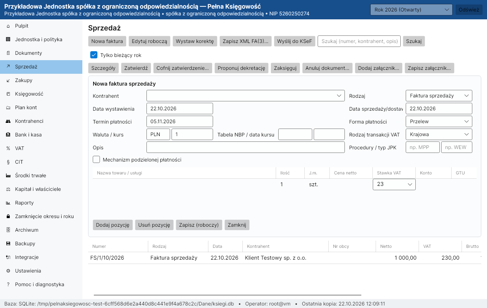
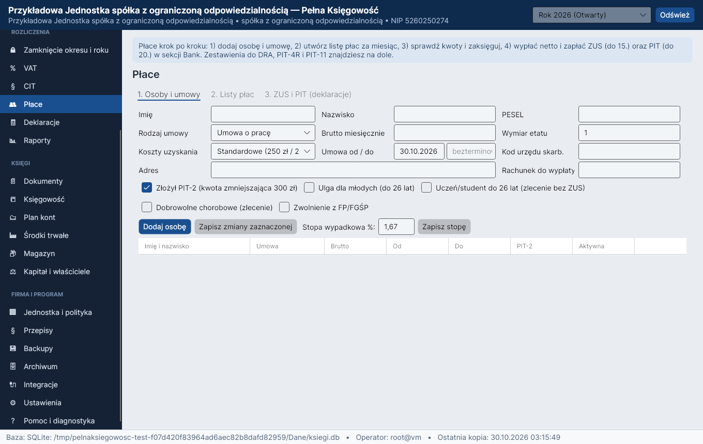
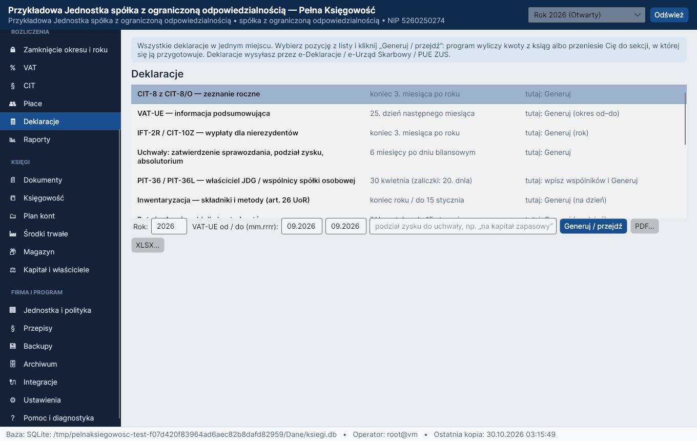

# Pełna Księgowość

Aplikacja desktopowa na **Windows i Linux** do prowadzenia ksiąg rachunkowych, ewidencji,
rozliczeń podatkowych, obsługi dokumentów i przygotowywania raportów. Projekt jest w trakcie
wdrażania i weryfikacji; **nie posiada obecnie zatwierdzonego wydania produkcyjnego ani
potwierdzenia pełnej zgodności prawno-podatkowej**.

> **Ważne:** program wymaga weryfikacji przed użyciem w realnej księgowości. Wyniki obliczeń podatkowych, list płac i raportów należy porównać z niezależnymi przykładami i aktualnymi przepisami. Testy CI nie stanowią certyfikacji prawnej.

**Aktualna architektura pracy:** jedna **centralna baza PostgreSQL na jednostkę**. Program odrzuca bazę zawierającą wiele jednostek, ponieważ role operatorów nie mają jeszcze udowodnionej izolacji per jednostka. Bezpośredni dostęp SQL wymaga osobnego ograniczenia uprawnień po stronie serwera. Każdy operator
używa osobnego loginu PostgreSQL nadanego przez administratora; identyfikator w programie
ma postać `db:login`. Ten sam login może być użyty na kilku urządzeniach, ale **tylko jedna
aktywna instancja programu na login jednocześnie** (sesyjna blokada serwera). Techniczne
połączenia SQL w obrębie tej samej instancji nie są w ten sposób limitowane. SQLite jest
wykorzystywana w odizolowanych autotestach i wybranych operacjach odzyskiwania, **nie jako
standardowa baza robocza**.

## Status funkcji i bezpieczeństwa

| Obszar | Stan |
|---|---|
| Wspólna baza ksiąg | PostgreSQL; wymaga indywidualnych kont SQL i administracji serwerem |
| Operatorzy i role | Loginy `db:login`, role w aplikacji, blokada jednej aktywnej sesji na login |
| Uprawnienia PostgreSQL | **Wymagają utwardzenia po stronie serwera**; sama rola aplikacyjna nie zabezpiecza bezpośredniego SQL |
| Równoległa praca | Wymagane dalsze testy numeracji, transakcji i konfliktów zapisów |
| Załączniki | Mogą pozostawać na lokalnym dysku; **nie są automatycznie współdzielone między stanowiskami** |
| Archiwum PDF | Osobny statyczny PDF dla dowodu i indeks SHA-256; nie zastępuje elektronicznych oryginałów i załączników |
| KSeF, JPK, VAT, PIT/CIT, ZUS | Implementacja wymaga niezależnej weryfikacji merytorycznej i prawnej |
| Kopie i odtwarzanie | Dostępne narzędzia; pełna procedura odtworzenia produkcyjnego PostgreSQL wymaga sprawdzenia |

## Najważniejsze cechy

**Dla osób bez przygotowania księgowego:**

- **Asystent kontroli ksiąg** na Pulpicie — sam wykrywa błędy, niezgodności i zaległości (dokumenty niezaksięgowane
  w terminie, brak odliczenia VAT, faktury dla firm bez KSeF, duplikaty, płatności gotówkowe ponad 15 000 zł,
  niezapłacone faktury po 90 dniach, ujemna kasa, salda po złej stronie, brak wyciągów, amortyzacji, kopii…),
  objaśnia je prostym językiem i prowadzi do miejsca naprawy.
- **Kalendarz terminów** — JPK_V7M/V7K i VAT, zaliczki CIT, ZUS i PIT od wynagrodzeń, PIT-4R/PIT-11, JPK_CIT,
  zaksięgowanie miesiąca, sprawozdanie finansowe, CIT-8.
- **Sekcja „Deklaracje”** — wszystkie deklaracje w jednym miejscu z terminami: CIT-8 z CIT-8/O, VAT-UE, IFT-2R/CIT-10Z,
  PIT-36/PIT-36L (właściciel, wspólnicy), uchwały roczne, inwentaryzacja (metody, potwierdzenia sald, protokół kasy)
  oraz skróty do JPK_V7, JPK_CIT, ZUS DRA/RCA, PIT-4R/PIT-8AR/PIT-11 i sprawozdania.
- **Rodzaje wydatków** (paliwo, samochód osobowy, telefon, najem, hotel, restauracja, reprezentacja…) — program sam
  dobiera konto, procent odliczenia VAT i część kosztu nieuznawaną podatkowo.
- **Kreator „Rozlicz miesiąc”** — dokumenty, bank, amortyzacja, VAT, JPK, zaliczka CIT, kopia i zamknięcie, każdy
  krok jednym przyciskiem. **„Zapisz i zaksięguj”** w fakturach.
- **Kreator planu kont** dopasowany do działalności, **biała lista VAT** (dane kontrahenta po NIP, sprawdzenie
  rachunku), **kurs NBP** jednym przyciskiem, **rodzaje operacji bankowych** zamiast numerów kont, objaśnienia
  w każdej sekcji i słowniczek pojęć.

**Księgowość:**

- **Silnik księgowy**: podwójny zapis Wn/Ma z kontrolą bilansowania, kwoty wyłącznie `decimal`, zapisy zaksięgowane
  niemodyfikowalne (logika + wyzwalacze bazy), korekty tylko stornem, ciągła numeracja dziennika i łańcuch skrótów
  SHA-256 wykrywający manipulacje, bufor zapisów.
- **Okresy i rok obrotowy**: lista kontrolna przed zamknięciem miesiąca, kontrolowane ponowne otwarcie
  z uzasadnieniem, zamknięcie roku z automatycznym bilansem otwarcia i przeniesieniem rozrachunków.
- **Dokumenty**: faktury sprzedaży i zakupu, korekty, noty, PK, dowody wewnętrzne, załączniki z sumą SHA-256,
  zatwierdzanie i dekretacja (propozycja + edycja), historia zmian.
- **Forma prawna jednostki** wpływa na plan kont (nazwa kapitału podstawowego), politykę rachunkowości,
  kontrolę firmy i KRS, dostępność CIT (spółki osobowe i osoby fizyczne → PIT wspólników) i wymogi zdarzeń kapitałowych.
- **VAT i JPK**: rejestry, wyliczenie deklaracji (miesięcznej i kwartalnej), rozliczenie na kontach, pliki JPK_V7M
  i JPK_V7K (wersje 2 i 3, także dla osoby fizycznej), JPK_CIT (JPK_KR_PD — księgi ze znacznikami MF), VAT-UE —
  **walidowane oficjalnymi schematami XSD Ministerstwa Finansów** dołączonymi do programu (`schemas/MF`);
  **KSeF 2.0** — wyłącznie pobieranie faktur zakupu (logowanie tokenem lub certyfikatem, XAdES); faktury sprzedaży wystawia się w KSeF poza programem i wpisuje ich numer KSeF. Plik FA(3) można zapisać (walidacja schematem).
- **Bank i kasa**: import MT940 i CSV, dopasowanie do rozrachunków, księgowanie, operacje kasowe; rozrachunki
  z wiekowaniem i kompensatami.
- **CIT** (zaliczki, uzgodnienie wyniku bilansowego z podatkowym, CIT-8), **PIT** właściciela i wspólników,
  **płace** (umowa o pracę, zlecenie, dzieło, powołanie; ZUS, zdrowotna i PIT 2026, PPK, choroba, urlop bezpłatny,
  listy płac z księgowaniem, DRA/RCA, PIT-4R, PIT-8AR, PIT-11), **magazyn** (PZ/WZ/RW/PW, cena przeciętna lub FIFO,
  spis z natury),
  **środki trwałe** (amortyzacja bilansowa i podatkowa), **kapitał i właściciele** (wkłady, podział zysku, dywidendy, pożyczki — po potwierdzeniu dokumentów).
- **Sprawozdanie finansowe**: bilans, RZiS porównawczy i kalkulacyjny (klucz podziału kosztów), zestawienie zmian
  w kapitale, rachunek przepływów (metoda pośrednia), informacja dodatkowa (tabele z ksiąg + opisy), informacja
  o podatku dochodowym; **e-Sprawozdanie XML w oficjalnej strukturze SFJINZ(2)** walidowane schematem MF.
- **Monitor przepisów** — sprawdza zmiany ustaw (API Sejmu) i pokazuje je w panelu; **weryfikacja kontrahenta**
  w bezpłatnych rejestrach (biała lista VAT, KRS — likwidacja/upadłość/restrukturyzacja, VIES).
- **Raporty** z rzeczywistych zapisów: dziennik, księga główna, zestawienie obrotów i sald, bilans, RZiS,
  rejestry VAT, rozrachunki, środki trwałe, uzgodnienia, dziennik zdarzeń, kontrola integralności —
  eksport do **PDF, XLSX i CSV**; sprawozdanie finansowe w XML.
- **Kopie zapasowe** szyfrowane AES-256-GCM, weryfikowane po zapisie, odtwarzanie do nowej lokalizacji,
  kopie automatyczne i przy zamknięciu programu, opcjonalnie w OVHcloud Object Storage (S3).
- **Logowanie operatora przez PostgreSQL**: każdy operator ma odrębny login serwera;
  administrator rejestruje odpowiedni identyfikator `db:login` i nadaje role w aplikacji.
  Dostęp wymaga również właściwych uprawnień i konfiguracji TLS po stronie PostgreSQL.
  Hasła oraz klucze trafiają do magazynu sekretów systemu operacyjnego, a nie do pliku JSON.

| Wydatek z kategorią | Rozlicz miesiąc |
|---|---|
|  |  |
| **Kreator pierwszego uruchomienia** | **Faktura sprzedaży** |
|  |  |
| **Płace** | **Deklaracje** |
|  |  |

## Pobranie i instalacja

Trwają prace rozwojowe i przeglądy. Stare wydania zostały wycofane; obecnie nie ma oficjalnego wydania.
Wersja programu: **1.0.0** (bez nowych wydań). Aktualny kod znajduje się na gałęzi **main**.
Pakiety testowe są budowane w GitHub Actions jako artefakty; publikacja w **Releases** wymaga osobnego,
świadomego uruchomienia workflow z numerem wydania.

Docelowe formaty pakietów (bez potrzeby instalowania .NET):

| System | Pakiet |
|---|---|
| Windows 10/11 x64 | `PelnaKsiegowosc-<wersja>-x64.msi` (instalator) lub `PelnaKsiegowosc-<wersja>-win-x64.zip` (przenośny) |
| Linux x64 (Debian/Ubuntu) | `pelnaksiegowosc_<wersja>_amd64.deb` |
| Linux x64 (inne dystrybucje) | `PelnaKsiegowosc-<wersja>-linux-x64.tar.gz` z `install.sh` (bez uprawnień administratora) |

Instrukcja: [docs/INSTALL.md](docs/INSTALL.md). Kompilacja ze źródeł: [docs/BUILD.md](docs/BUILD.md).

## Dokumentacja

| Dokument | Treść |
|---|---|
| [docs/INSTALL.md](docs/INSTALL.md) | Instalacja, aktualizacja, odinstalowanie, położenie danych (Windows i Linux) |
| [docs/USER_GUIDE.md](docs/USER_GUIDE.md) | Instrukcja obsługi: kreator, codzienna praca, zamknięcie miesiąca i roku, kopie |
| [docs/BUILD.md](docs/BUILD.md) | Kompilacja, testy, budowanie pakietów MSI, zip, deb, tar.gz |
| [docs/ARCHITECTURE.md](docs/ARCHITECTURE.md) | Architektura: warstwy, dane, niezmienność zapisów, integracje |
| [docs/ACCOUNTING_REQUIREMENTS.md](docs/ACCOUNTING_REQUIREMENTS.md) | Wymagania księgowe i sposób ich realizacji |
| [docs/COMPLIANCE_MATRIX.md](docs/COMPLIANCE_MATRIX.md) | Macierz zgodności z przepisami (z oznaczeniem pozycji do weryfikacji) |
| [docs/SECURITY.md](docs/SECURITY.md) | Model bezpieczeństwa programu |
| [docs/TEST_PLAN.md](docs/TEST_PLAN.md) | Plan testów i sposób ich uruchamiania |
| [docs/IMPLEMENTATION_PLAN.md](docs/IMPLEMENTATION_PLAN.md) / [docs/PROGRESS.md](docs/PROGRESS.md) | Plan i stan prac, znane ograniczenia |
| [LICENSE](LICENSE) / [LICENSE.pl.md](LICENSE.pl.md) | Licencja: wolno używać (także w firmie), modyfikować i publikować; zakaz sprzedaży |
| [SECURITY.md](SECURITY.md) / [CONTRIBUTING.md](CONTRIBUTING.md) | Zgłaszanie podatności, zasady współtworzenia |
| [THIRD-PARTY-NOTICES.md](THIRD-PARTY-NOTICES.md) / [schemas/README.md](schemas/README.md) | Licencje bibliotek, oficjalne schematy XSD |

## Konfiguracja centralnej bazy i operatorów

1. Administrator przygotowuje serwer PostgreSQL, bazę, połączenie z weryfikacją TLS
   i osobne konto SQL dla każdej osoby. **Nie należy udostępniać operatorom konta superuser,
   właściciela schematu ani konta do migracji.**
2. Administrator rejestruje w programie operatora jako `db:login` i przydziela role.
   Konto SQL i konto aplikacyjne to **dwie oddzielne czynności**.
3. Użytkownik wpisuje na swoim stanowisku adres serwera, nazwę bazy, swój login
   i hasło. Ponowne otwarcie programu na drugim urządzeniu z tym samym loginem jest
   możliwe po zakończeniu aktywnej sesji na pierwszym.
4. Administrator ustala wspólną, kontrolowaną i szyfrowaną lokalizację załączników
   oraz strategię spójnych kopii bazy i plików. Stanowiska mogą wskazywać ten sam katalog współdzielony
   i muszą używać tego samego klucza załączników. Zapis używa osobnych plików tymczasowych per operacja.
   Test dwóch instancji magazynu nie zastępuje próby rzeczywistego udziału sieciowego, jego uprawnień i awarii.
   Oddzielne lokalne katalogi nie współdzielą załączników.
5. Migracje schematu są zadaniem administracyjnym. Polecenie
   `pk-cli aktualizuj-schemat --potwierdzam` wymaga aktywnego administratora,
   zamknięcia pozostałych sesji i zweryfikowanej kopii bezpieczeństwa.
   Przed użyciem na rzeczywistych danych przetestuj odtwarzanie.

**Archiwizacja papierowa:** w sekcji *Dokumenty* znajduje się opcja
*Archiwizuj wszystkie dowody do PDF*. Eksport tworzy statyczne wydruki dokumentów
i indeks z sumami SHA-256. PDF można technicznie zmodyfikować; hash służy do
wykrywania niezgodności, ale nie zastępuje podpisu ani niezależnego,
chronionego indeksu. **Eksport nie obejmuje automatycznej konwersji wszystkich
załączników i nie zastępuje oryginalnych faktur KSeF/XML.**

## Zakres bieżących prac: prosta spółka akcyjna

Prace naprawcze na `main` dotyczą P.S.A., z zachowaniem wersji **1.0.0**.
Testy wspólnych usług korzystają z jednostki P.S.A. (`TestBooks`). Sprawdzane są m.in. wniesienie wkładów,
kapitał akcyjny, CIT, VAT/JPK, płace i bezpieczeństwo. Zaksięgowanie zdarzenia kapitałowego P.S.A.
ponownie sprawdza wymagane dokumenty, potwierdzenie dopuszczalności wypłaty i zakres kwot podatku.
To zabezpieczenie nie zastępuje ustalenia kwoty do podziału, prognozy wypłacalności ani obowiązku z art. 300^19 KSH.
Szczegółowy stan i nieusunięte ograniczenia: [raport prac nad P.S.A.](docs/PSA_REPAIR_REPORT_2026-10-31.md).

## Znane ograniczenia

- Oficjalne schematy XSD MF (JPK_V7M/V7K, JPK_KR_PD, e-Sprawozdanie SFJINZ(2), FA(3)) są dołączone do programu
  (`schemas/`). Workflow pobierania uruchamia się ręcznie lub po zmianie narzędzi pobierających; nie monitoruje stale nowych publikacji MF.
  Pobranie pliku nie potwierdza aktualności wzoru dla danego okresu ani poprawności kwot. Nowe schematy można też pobrać w *Ustawienia → Schematy XSD*.
- e-Sprawozdanie: struktury SFJINZ/SFJINT(2) (pełna), SFJMAZ/SFJMAT(2) (jednostka mała) i SFJMIZ/SFJMIT(2) (mikro) —
  w złotych lub w tysiącach złotych (zaokrąglenia do tysięcy sprawdź przed podpisaniem).
- Pliki XML e-Deklaracji: VAT-UE(5), korekta VAT-UEK(5) i PIT-11(29) z adresem zamieszkania (wzory dołączone do programu, walidowane schematem MF; okres obowiązywania wymaga sprawdzenia). CIT-8(34), PIT-4R(13),
  PIT-8AR(14), IFT-2R(12), PIT-36/36L oraz ZUS DRA/RCA — program udostępnia wyliczenia i zestawienia,
  ale nie deklaruje zweryfikowanego eksportu elektronicznego tych formularzy. MF publikuje struktury XML/CRWDE
  ([dokumentacja MF](https://podatki.gov.pl/e-deklaracje-zloz-deklaracje-podatkowa-online/bramka-ubd-i-dokumentacja-it)); brak obsługi w programie nie oznacza braku publicznego XSD;
  wysyłka elektroniczna (e-Deklaracje, e-Urząd Skarbowy, PUE ZUS/Płatnik) odbywa się poza programem.
- Płace: program nalicza wynagrodzenie chorobowe pracodawcy w ograniczonym modelu art. 92 KP (33/14 dni).
  Nie rozlicza w pełni zasiłków, podstaw historycznych, premii ani zmian etatu. Finansowanie świadczenia nie określa płatnika:
  przy zgłoszeniu powyżej 20 ubezpieczonych zasiłki co do zasady wypłaca płatnik składek
  ([ZUS](https://www.zus.pl/en/swiadczenia/zasilki/zasilek-chorobowy/postepowanie-w-sprawie-zasilkow/platnicy-zasilku)).
  Godzinowe rozliczenie urlopów i grafików zmianowych pozostaje ograniczeniem.
- KSeF: interfejs użytkownika udostępnia pobieranie faktur zakupu (faktury sprzedaży wystawia się w KSeF poza programem i wpisuje ich numer).
  Warstwa usług ma także wysyłkę sprzedaży testowaną na atrapie API; brak potwierdzonej próby na serwerze MF.
  Zapisany numer referencyjny nierozstrzygniętej wysyłki blokuje ponowne wysłanie; uzgodnienie wymaga sprawdzenia statusu poza tym przebiegiem.
  Logowanie tokenem albo certyfikatem (.pfx — podpis kwalifikowany, pieczęć, certyfikat KSeF). Profil Zaufany
  wymaga podpisania pliku na stronie gov.pl — program przyjmuje wtedy certyfikat KSeF.
- Biała lista VAT i kursy NBP: integracje sprawdzone testami na atrapach API (publiczne API MF i NBP).
- Reguły kategorii wydatków odpowiadają typowym przypadkom — w nietypowej sytuacji procenty (VAT, NKUP) zmienia się
  ręcznie w pozycji faktury.
- Mapowania podatkowe i księgowe wymagają weryfikacji przez księgowego lub doradcę podatkowego
  ([docs/COMPLIANCE_MATRIX.md](docs/COMPLIANCE_MATRIX.md)).

## Licencja

Kod jest jawny (*source-available*): program można bezpłatnie używać — także w firmie do prowadzenia jej
ksiąg — kopiować, modyfikować i publikować na tej samej licencji. **Sprzedaż programu, odpłatna dystrybucja
i oferowanie go jako płatnej usługi są zabronione** bez odrębnej zgody licencjodawcy. Szczegóły:
[LICENSE](LICENSE), skrót: [LICENSE.pl.md](LICENSE.pl.md).

## Odpowiedzialność

Program jest udostępniany bez jakichkolwiek gwarancji. **Pełną odpowiedzialność za księgi rachunkowe,
deklaracje, pliki JPK, faktury KSeF, sprawozdania finansowe i rozliczenia z urzędem skarbowym ponosi
użytkownik** — w tym za weryfikację wyników przed ich wykorzystaniem. Autor programu nie odpowiada za
zaległości podatkowe, odsetki, kary, sankcje ani inne szkody wynikające z korzystania z programu.
Program nie stanowi porady prawnej, podatkowej ani księgowej. Szczegóły: § 6 pliku [LICENSE](LICENSE).
